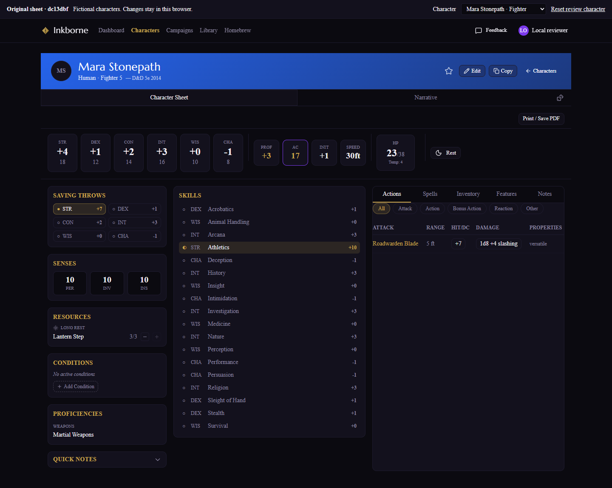
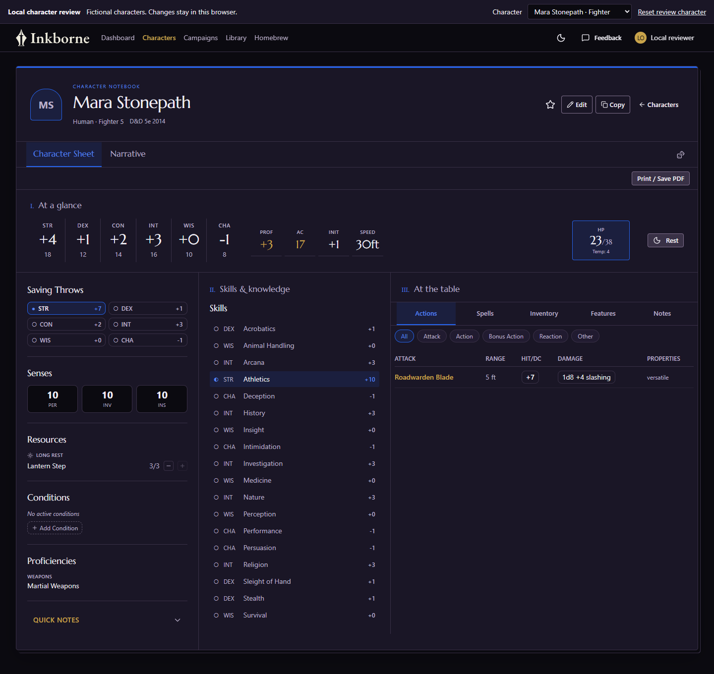
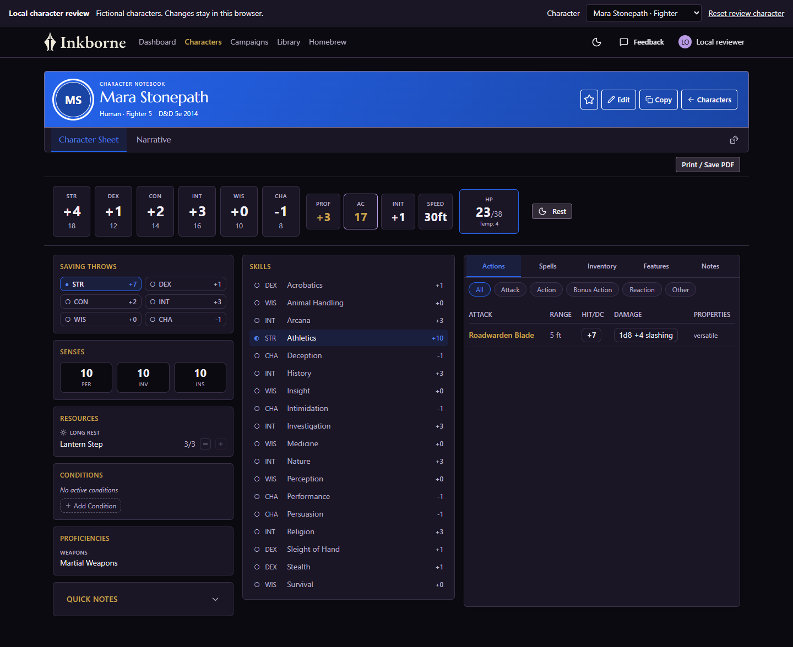
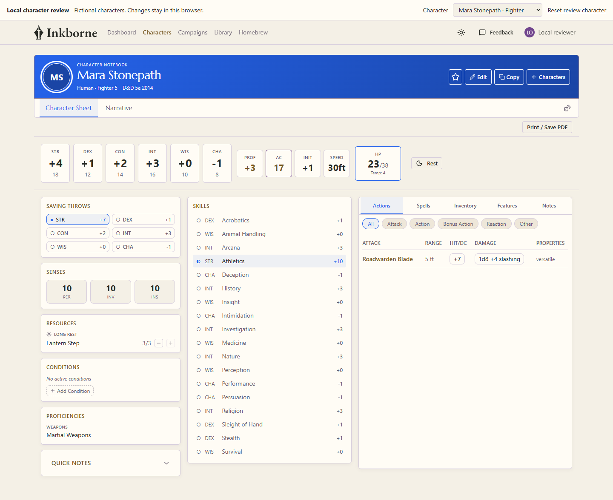

# Character sheet visual baseline

23 October 2026. The first notebook sheet refresh was found too sanitized. This reference records the actual original sheet before further application changes.

## Evidence

- Original component source: `dc13dbf2050ccc010438c0e0a8685ff992eb3e57`, immediately before this visual refresh.
- Compared draft: `f596917`, using identical original fictional fighter data, a blue accent, Dark theme, and a 1440 × 1000 browser viewport. Screenshots include the full page. No real account or hosted character was used.
- The original components were rendered from an unchanged baseline checkout, with its own production CSS/fonts. Its supported Webpack build was used because its shared dependency junction is outside Turbopack's filesystem root. No application source or dependency files were changed to build the reference.
- The comparison browser check passed with external requests blocked. Both renderers use the same local persistence adapter at their external boundaries; this is visual evidence, not hosted hydration or backend acceptance.
- Interactive local comparison: <http://127.0.0.1:3195/comparison>. Original reference: <http://127.0.0.1:3195/>. Current revised draft: <http://127.0.0.1:3194/>.

| Original sheet | First draft |
| --- | --- |
|  |  |

## Visual anchors to preserve

| Element | Original treatment | What the first draft lost |
| --- | --- | --- |
| Character identity | Broad character-colored gradient, bright identity text, integrated controls | Color reduced to a thin top border and small highlights on a neutral header |
| Statistics | Compact, independently bounded ability and combat tiles with a strong numerical hierarchy | Tiles flattened into a divider-based editorial strip |
| Section hierarchy | Compact gold labels, purple brand contrast, distinct panel surfaces | Mostly neutral serif headings and continuous ruled columns |
| Density and depth | A compact header and clearly grouped play tools | Larger framing, more whitespace, and less distinction between groups |

The original header measured about 86 px tall in this matched case; the draft's measured about 152 px. The larger draft header carried less character color despite occupying more space. These are observed values for this fixture, not fixed layout targets.

The original filled sheet was not covered in decorative inkstains or quills. Its identity came from color, typography, compact play controls, and panel hierarchy. Additional notebook ornament alone would not address this feedback.

## Keep from the technical refresh

The selected Scribe identity, genuine Light/Dark support, readable derived character colors, portal theme propagation, focus treatment, working controls, and mobile usability remain useful. These improvements are retained in the second local composition below. It is implemented for review; the user subsequently approved this second composition for dev deployment.

## Revised local composition

The second composition restores a substantial personalized banner, circular portrait, bounded stat tiles, gold labels, purple brand controls, and distinct play panels. The matched Dark/Blue/Mara screenshot uses the same 1440 × 1000 viewport as the original above. Light and mobile show the same saved blue source across different surfaces.

| Revised Dark | Revised Light |
| --- | --- |
|  |  |

[Mobile Light screenshot](revision-mobile-light-blue.png). The leading banner stop retains the exact player color; opaque black/white ink and a monotone sRGB gradient provide readable identity text. Theme-aware body roles, independent semantic colors and global brand scope remain separate. Existing mechanics, writers and print behavior are unchanged.

## Working method

Before visual edits, render the existing screen, capture representative views, and name the visual anchors to preserve. Use matched data, theme, viewport, and accent for comparison; review both modes and mobile as the revision develops. Keep functional verification separate from visual acceptance. Do not use the first sheet draft as the default template for later screens.

The external comparison harness and process metadata are retained locally in `C:\Users\kaios\.codex\visualizations\2026\10\22\01a16436-7198-7ef1-aba1-c0c6dcf44392\sheet-original-comparison`. Its loopback server is intentionally retained for review; `bundle/server-process.json` records its exact process details. The existing draft server was preserved.
