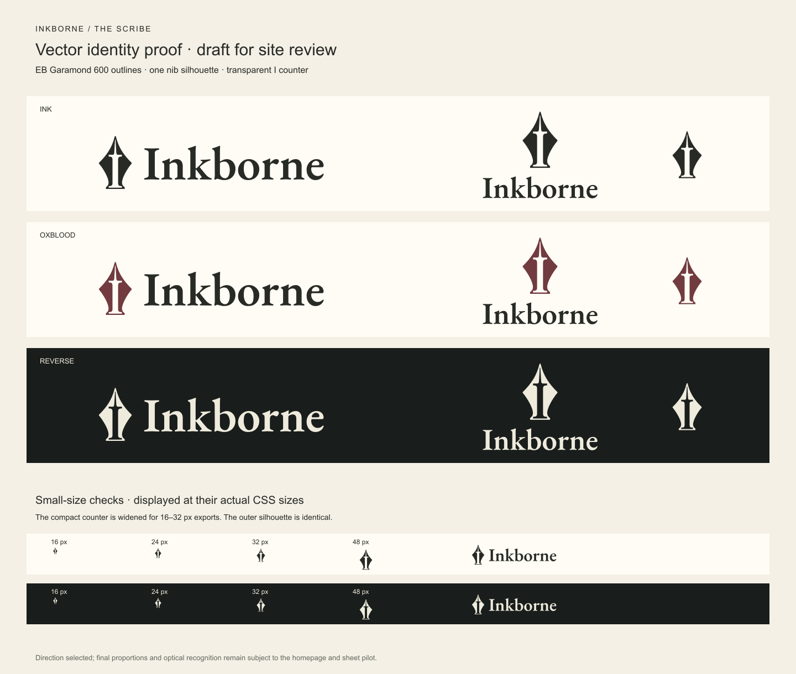

# Inkborne — The Scribe / draft vector identity

The user selected the refined A direction, with monochrome as the primary treatment and oxblood as an alternate. These assets put that direction into a reproducible vector form for the homepage and character-sheet pilot. **Final visual approval is pending seeing it in the site.** Nothing in this directory replaces production assets.



## Master and derivatives

- [source.json](source.json) holds the symmetric nib contours, counter, palette, outline-font reference, and layout proportions. Edit that source and regenerate; do not edit derivatives separately.
- [inkborne-master.svg](inkborne-master.svg) is the nib master, with a 320 × 512 viewBox and an axis at x = 160. Its capital I is a true transparent cutout in an even-odd compound path. No background-colored patch is used.
- All horizontal and stacked wordmarks are **EB Garamond, weight 600, converted to paths** from the licensed variable font in [the fonts directory](../fonts/). They do not require the viewer to have that font installed.
- `inkborne-horizontal-{ink,oxblood,reverse}.svg` and `inkborne-stacked-{ink,oxblood,reverse}.svg` are transparent lockups. Ink uses `#282A25`; reverse uses `#EEEBDD`; oxblood uses `#713B40` for the nib and ink for the wordmark.
- `inkborne-symbol-{ink,oxblood,reverse}.svg` are square transparent symbol exports. The `-small.svg` alternates widen the internal counter while retaining the same outer contour, for icons at 16–32 px. Small optical versions are deliberate derivatives of the same source, not another logo.
- Transparent PNG lockups, symbol PNGs at 16/24/32/48 px, paper-backed app icons at 180/192/512 px, reverse app icons, and a paper-backed SVG/PNG/ICO favicon are included. The ICO contains independently rendered 16/32/48 px images.
- [manifest.json](manifest.json) records dimensions, hashes, font provenance, and the complete list of generated exports. [proof.svg](proof.svg) embeds the same vector paths for a resolution-independent inspection board; `proof.png` is its rendered counterpart.

## Placement for the pilot

Use the horizontal mark for navigation and the standalone symbol only where the name is already clear. Start navigation studies at 160–180 CSS px wide and keep the intrinsic aspect ratio (about 4.238:1). The pilot also tests smaller mobile, app-header, and footer placements down to 112 px. Those are comparison sizes, not an established minimum; confirm readability in context before fixing the production minimum. The stacked layout is about 1.322:1. Use external clear space at least one-quarter of the nib height on all sides of a lockup.

The square icons include a 12% inset on each side. Their narrow nib silhouette is intentional: do not stretch it to fill a square. At 16 px the silhouette and central opening remain visible, but the full I is a secondary detail. Use at least 24 px for an interface symbol when recognition of the internal initial matters.

Keep every mark one solid color. Use ink on paper, reverse on the dark palette, or the oxblood nib with an ink wordmark on paper. Do not add gradients, outlines, drop shadows, textured fills, or multicolored internals. Preserve the transparent counter.

## Regeneration

From the repository root, run:

```powershell
python docs/design-briefs/field-journal-pilot/brand/make_assets.py
```

The current workstation's system Python is `C:\Users\kaios\AppData\Local\Programs\Python\Python311\python.exe`, with fontTools 4.60.1 and Pillow installed. `make_assets.py` instances EB Garamond at weight 600, reads the font's pair kerning, converts the lettering to paths, writes the SVG variants, and calls `render-assets.cjs` with Node to render PNGs through the already bundled `sharp`. Pillow packages the existing small PNGs into the ICO. No installation, background server, or external service is required.

The default bundled Node module path is the local Codex runtime. On another workstation, point `INKBORNE_NODE_MODULES` at a directory containing `sharp`; `node` and `python` must be available. The source font is checked against its SHA-256 before generation. Its license remains alongside the source font.

Text sources and generated SVGs use LF line endings. The directory's `.gitattributes` preserves these and marks raster/font files as binary so Git checkout conversion does not invalidate the manifest hashes.

The separate Latin font subset used by the page pilot is not required to render these outlined logo assets. It was built with fontTools from the same licensed source using this command:

```powershell
python -m fontTools.subset 'docs/design-briefs/field-journal-pilot/fonts/EBGaramond[wght].ttf' --output-file=docs/design-briefs/field-journal-pilot/fonts/EBGaramond-latin.ttf --unicodes=U+0020-007E,U+00A0,U+00B7,U+00D7,U+2013-2014,U+2018-2019,U+201C-201D,U+2026,U+2192,U+2212,U+FFFD --layout-features='*' --name-IDs='*' --name-languages='*' --notdef-glyph --notdef-outline --recommended-glyphs
```

## Review limits

The proof board and icon exports were rendered and visually inspected. Vector transparency, raster dimensions, ICO sizes, and source symmetry are checked independently during delivery. The field-journal pilot is the next visual check for proportions, the final minimum lockup size, and the choice between ink and oxblood. Final appearance remains subject to that context review.
