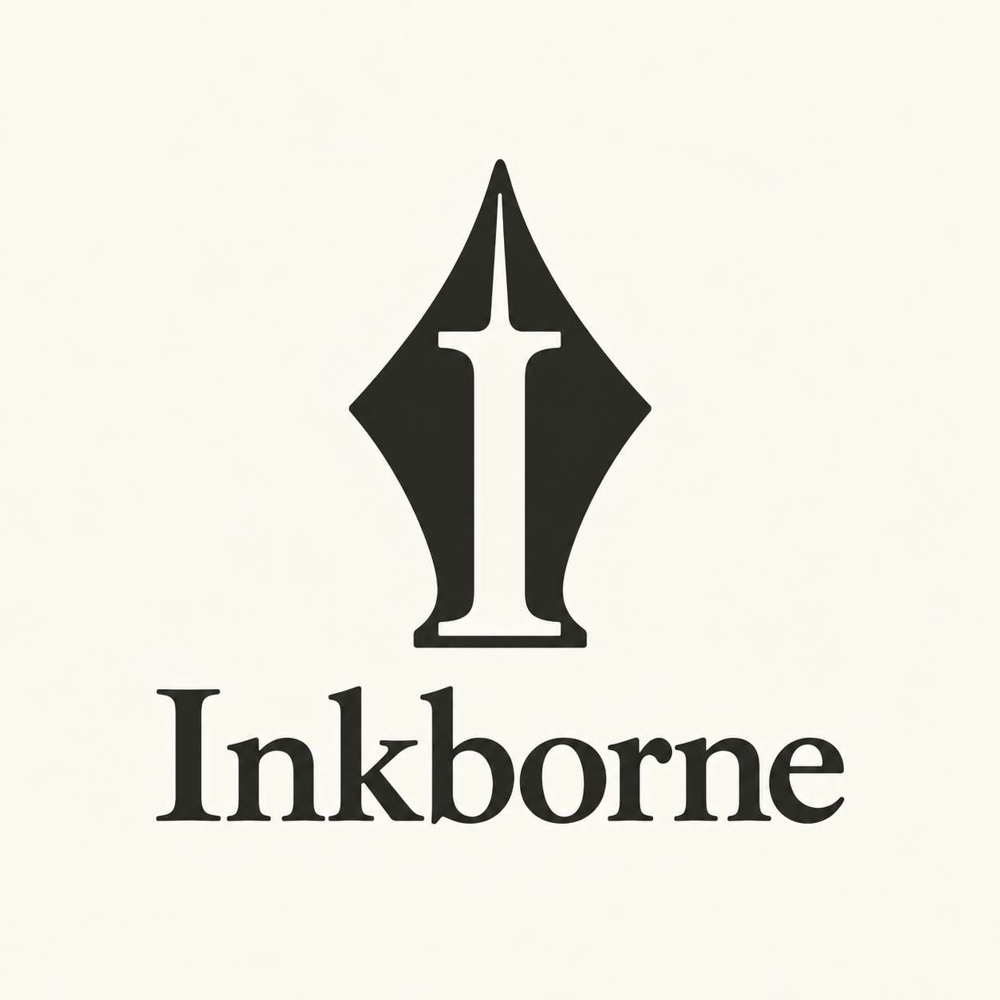
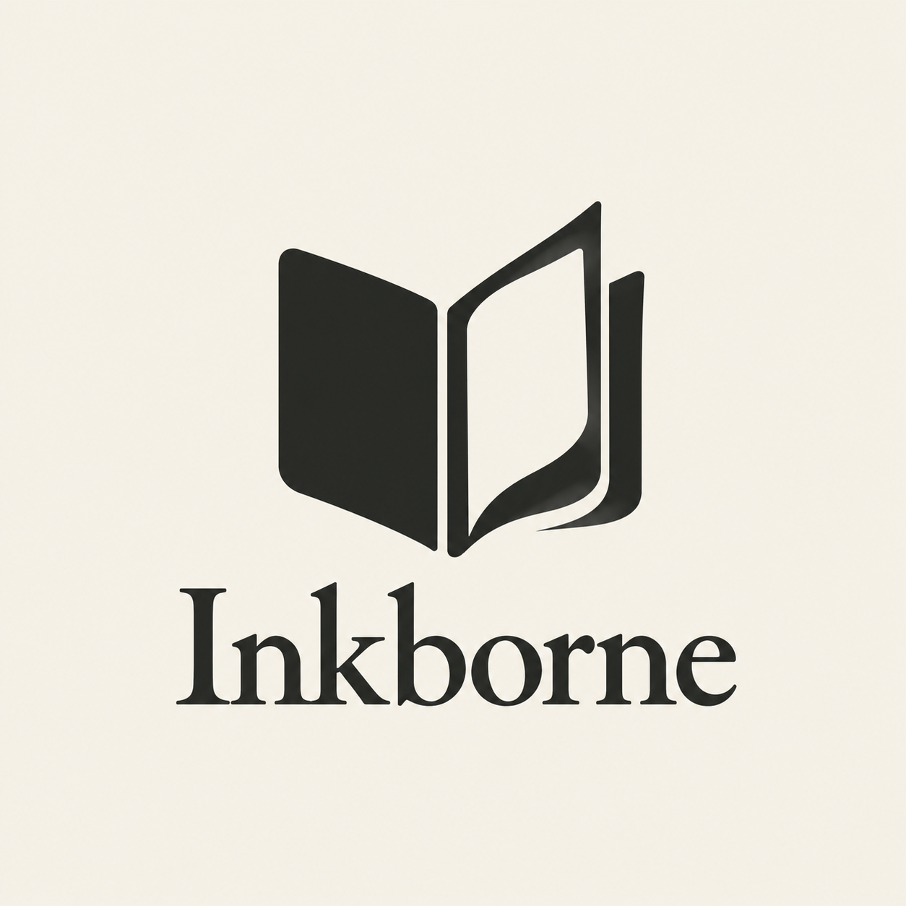
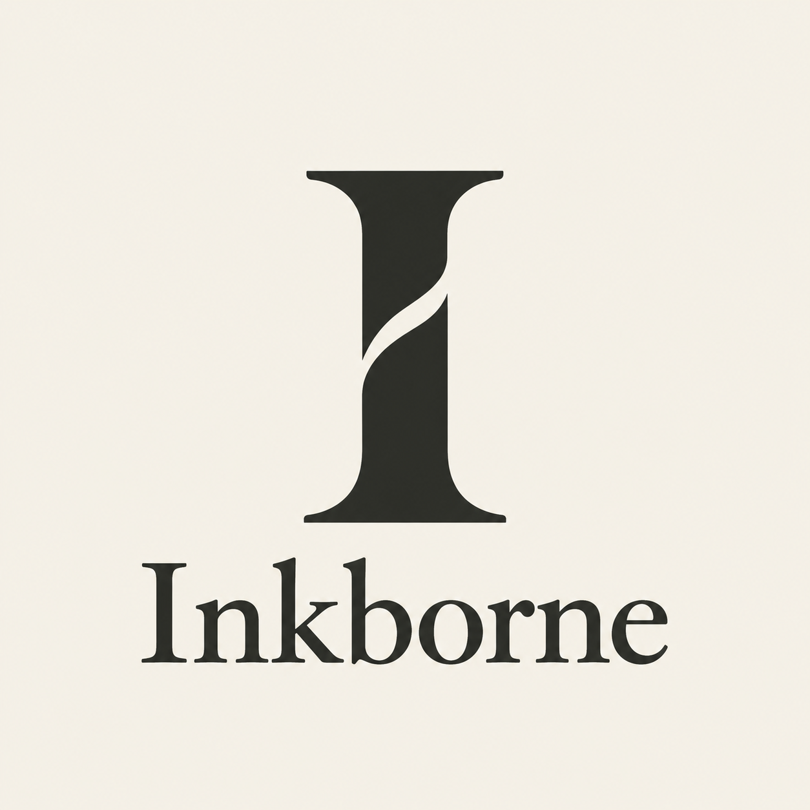

# Inkborne logo exploration

22 October 2026 · First round archive · A selected for development

Three logo directions explore the [Inkborne brand guide](../../brand-reference.md). The user selected A and agreed to continue with monochrome as the primary treatment and an oxblood alternate, subject to seeing it in the site. These original raster concepts remain the exploration archive. Follow the [vector and homepage context pilot](../field-journal-pilot/README.md) for the next revision.

## Compare the directions

| A · The Scribe | B · The Folio | C · The Initial |
| --- | --- | --- |
|  |  |  |
| A pen nib with a capital I cut into it. | A folded record or journal. | A substantial serif initial. |

**Recommendation: A, using the refined version above.** It makes the clearest connection between ink and Inkborne's initial. B emphasizes the journal but resembles a general reading-app logo. C is the quieter editorial alternative, with a less specific connection to the product.

The [original A](a-the-scribe.png) is retained for comparison. Its central cut suggested a sparkle. The [refinement](a-the-scribe-refined.png) replaces the pointed shoulders with a flatter typographic bar. Its slender upper slit still needs small-size evaluation during the vector pass.

## Review notes

| Direction | Strength | Refinement to consider |
| --- | --- | --- |
| A | Clear ink association and a compact initial-based identity. | Balance the negative space; keep the upper slit legible and the I distinct from a sword or sparkle. |
| B | Readable journal association and a broad silhouette. | Reduce the curled-page detail and establish a more distinctive shape. |
| C | Simple editorial character and a sturdy initial. | Make the diagonal cut feel deliberate and ensure the mark remains identifiable without the wordmark. |

The generated wordmarks spell Inkborne clearly, but they are not an actual EB Garamond typography master. Rebuild the selected wordmark with the chosen font and deliberate spacing. The images also contain slight tonal variation; the final mark should use flat fills.

Small-size observations are visual predictions. Isolated-symbol favicon tests, reversed-color tests, and final geometry checks have not been performed on these raster concept sheets.

## Selection and production

Direction A is selected for development. Final visual confirmation depends on its fit in the site. Preserve B and C as historical alternatives rather than treating them as active brand options.

After selection:

1. Refine the selected symbol and wordmark together.
2. Build a clean SVG master with deliberate geometry and reliable lettering.
3. Test the symbol at 16, 24, 32, and 48 px, including light and dark backgrounds.
4. Derive horizontal, stacked, symbol-only, monochrome, brand-color, favicon, and app-icon exports from that master.
5. Add the accepted assets and usage rules to the brand guide before replacing product assets.

Selection of A authorizes its continued development, rather than deployment or replacement of product assets. The current product logo and favicon are unchanged.

## Generation record

All images were created with the built-in image-generation tool. No CLI/API fallback was used. The first three images were generated independently from the same brand constraints, in dark ink on warm ivory. A received one targeted edit to simplify its negative space.

- [Initial prompts](prompts.json)
- [A refinement prompt](refinement-prompt.json)
- [Image metadata and hashes](assets.json)

The PNGs are saved here with their prompts so future work can inspect the actual proposals rather than reconstructing them from conversation context.
